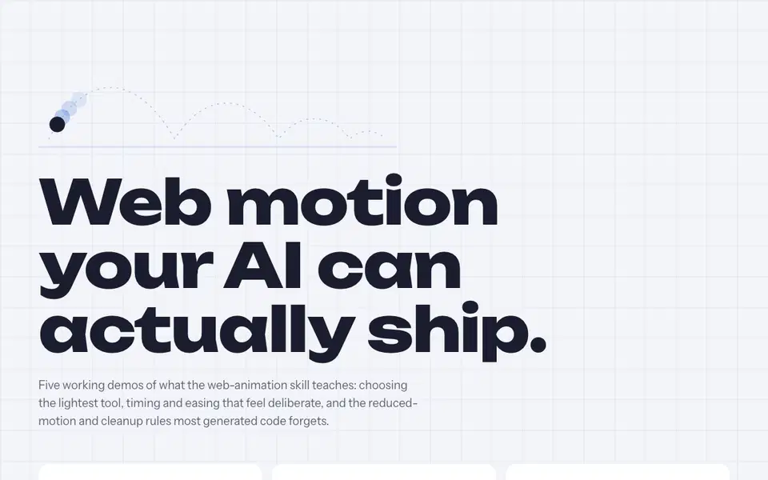
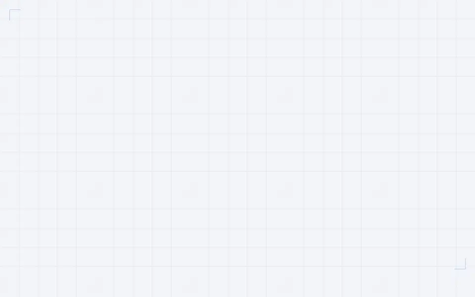
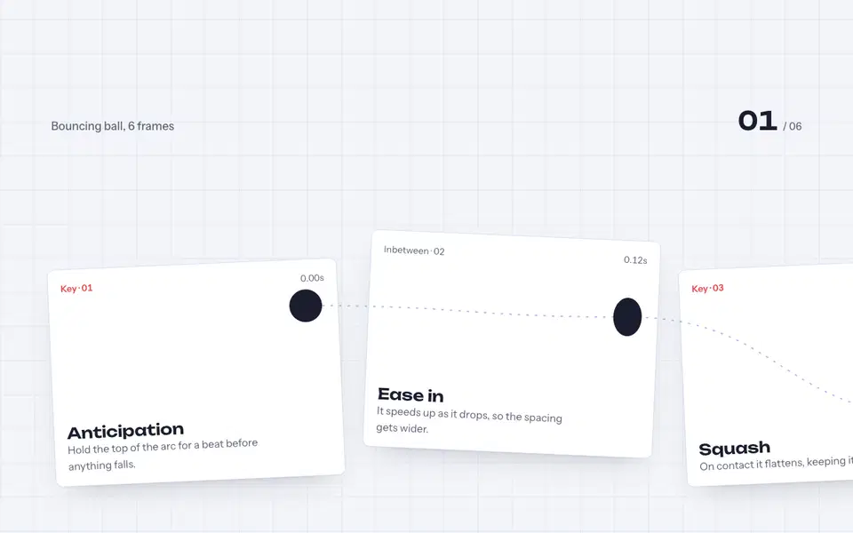
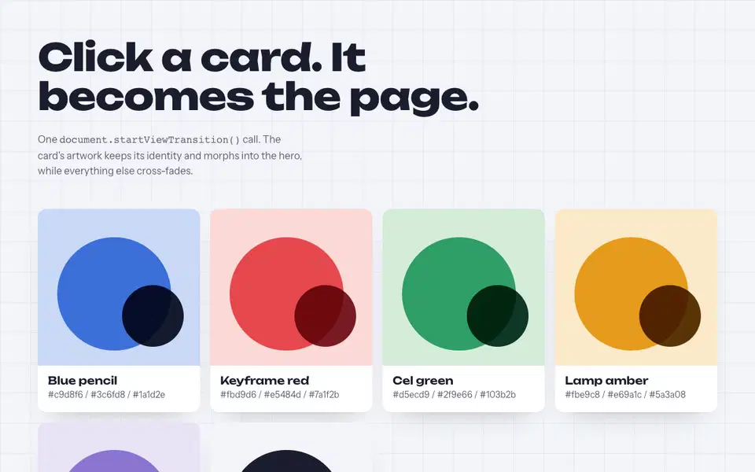
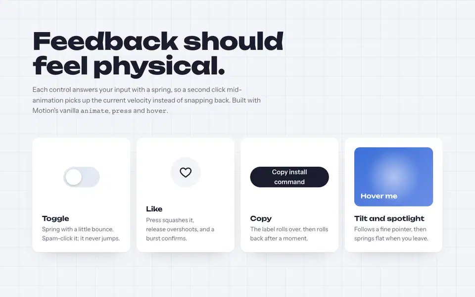
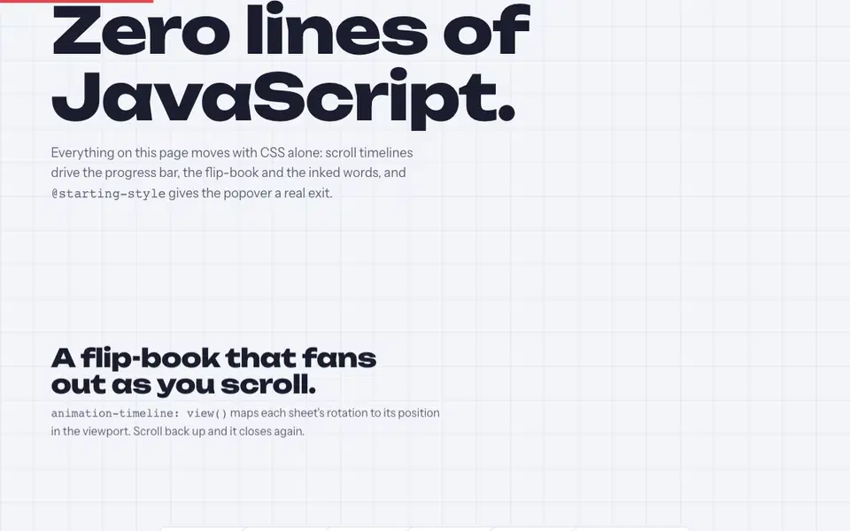

<p align="center">
  
</p>

<h1 align="center">Web Animation Skill</h1>

<p align="center">
  Teach your AI coding assistant to build web motion that feels designed: the right tool for the job, timing and easing that feel deliberate, and the accessibility and cleanup rules generated code usually skips.
</p>

<p align="center">
  <a href="#install">Install</a> ·
  <a href="#demos">Demos</a> ·
  <a href="#whats-inside">What's inside</a> ·
  <a href="#what-it-changes">What it changes</a>
</p>

---

## Install

```bash
npx skills add yuzhang-ai/web-animation-skill
```

Works with Claude Code, Codex, Cursor, GitHub Copilot and any assistant that reads `SKILL.md` skills. Then ask for motion the way you'd brief a designer:

> Add a hero entrance where the headline lines reveal from a mask, and make the pricing cards pin and stack on scroll.

## Demos

Each demo is a single HTML file in [`demos/`](demos/), built only from patterns in the rule files. Clone the repo and serve the folder:

```bash
python3 -m http.server 8000 --directory demos
```

Then open <http://localhost:8000>.

<table>
  <tr>
    <td width="50%">
      <a href="demos/split-text-hero.html"></a>
      <p><b>Masked line reveal</b> · GSAP SplitText + DrawSVG<br/>Lines rise from their own masks with <code>expo.out</code>, re-splitting on resize. Reduced motion gets a plain fade.</p>
    </td>
    <td width="50%">
      <a href="demos/scroll-storyboard.html"></a>
      <p><b>Pinned storyboard</b> · ScrollTrigger + Lenis<br/>One scrubbed timeline drives the horizontal move, the inked path, the frame counter and the progress bar.</p>
    </td>
  </tr>
  <tr>
    <td width="50%">
      <a href="demos/view-transition-gallery.html"></a>
      <p><b>Card becomes the page</b> · View Transitions API<br/>Shared-element morph with <code>view-transition-name</code>, no library, instant fallback.</p>
    </td>
    <td width="50%">
      <a href="demos/spring-controls.html"></a>
      <p><b>Spring controls</b> · Motion<br/>Interruptible springs via <code>press()</code> and <code>hover()</code>: spam-click the toggle and it never jumps.</p>
    </td>
  </tr>
  <tr>
    <td width="50%">
      <a href="demos/css-only.html"></a>
      <p><b>Zero lines of JavaScript</b> · CSS scroll timelines + <code>@starting-style</code><br/>A flip-book that fans out on scroll, words that ink in, and a popover with a real exit.</p>
    </td>
    <td width="50%" valign="top">
      <p><b>Every demo</b></p>
      <ul>
        <li>respects <code>prefers-reduced-motion</code></li>
        <li>keeps content visible if scripts fail</li>
        <li>works with a keyboard and keeps focus visible</li>
        <li>animates only <code>transform</code> and <code>opacity</code></li>
        <li>falls back to a simpler layout on small screens</li>
      </ul>
    </td>
  </tr>
</table>

## What's inside

`SKILL.md` is a short workflow the assistant follows every time:

1. **Read the project.** Use the animation library that's already installed; check the framework and SSR setup.
2. **Give every animation a job.** Feedback, orientation, attention or narrative, each with its own timing budget. No job, no animation.
3. **Pick the lightest tool.** Platform features first (CSS, `@starting-style`, View Transitions, scroll timelines), then libraries.
4. **Build with the non-negotiables.** Compositor-only properties, reduced motion, no content hidden before JS runs, cleanup on unmount, interruptible interactions.
5. **Verify in a real browser.** Mid-animation and rest-state screenshots, reduced-motion emulation, mobile width, scrolling both ways.

The rule files hold the detail, loaded only when a step needs them:

| Rule file | Covers |
|---|---|
| [motion-design.md](rules/motion-design.md) | Durations, easing tokens, choreography, what makes motion feel premium, common mistakes |
| [choosing-library.md](rules/choosing-library.md) | Decision flow, capability matrix, measured bundle sizes |
| [performance.md](rules/performance.md) | Compositor-only properties, profiling, `will-change`, reduced motion |
| [scroll-animations.md](rules/scroll-animations.md) | CSS scroll timelines, ScrollTrigger pinning and horizontal scroll, Lenis smooth scroll |
| [view-transitions.md](rules/view-transitions.md) | Same-document and cross-document transitions, shared elements, transition types |
| [css-keyframes.md](rules/css-keyframes.md) | Transitions, `@keyframes`, `@starting-style`, `linear()` springs, animating to `auto` |
| [gsap.md](rules/gsap.md) | Timelines, ScrollTrigger, SplitText, Flip, `matchMedia`, `useGSAP` |
| [framer-motion.md](rules/framer-motion.md) | Motion for React: variants, `AnimatePresence`, layout, gestures |
| [motion-one.md](rules/motion-one.md) | Motion vanilla JS: `animate`, sequences, `scroll`, `inView`, springs |
| [animejs.md](rules/animejs.md) | Anime.js v4: timelines, stagger, SVG drawing and morphing |
| [lottie.md](rules/lottie.md) | dotLottie player, controls, events |
| [rive.md](rules/rive.md) | State machines and inputs |
| [d3.md](rules/d3.md) | Data-join transitions |
| [flubber.md](rules/flubber.md) | Path morphing |
| [konva.md](rules/konva.md) | Canvas 2D shapes and tweens |
| [three-js.md](rules/three-js.md) | Scenes, React Three Fiber, performance |

APIs and browser support were checked against official docs and MDN browser-compat-data on 2026-11-11 (gsap 3.15, motion 14.12, animejs 4.5).

## What it changes

Without guidance, assistants tend to produce the same few patterns. The skill steers away from each one:

| Typical generated motion | With the skill |
|---|---|
| A fade-up on every section | One orchestrated moment, the rest left quiet |
| `transition: all 0.3s ease` everywhere | Listed properties, durations scaled by distance, ease-out for entrances |
| A library added for one hover effect | CSS first; reuse what's already installed |
| `framer-motion` imports, Anime.js v3 syntax, deprecated Lottie player | Current APIs: `motion/react`, Anime.js v4, dotLottie, `useGSAP` |
| Content hidden in CSS until JS runs | Hidden state applied by script, so content survives a failed load |
| No reduced-motion handling | Movement replaced with fades; scrubbed scenes become static |
| Modals that pop in and vanish | Enter and exit with `@starting-style` or `AnimatePresence` |
| "Done" after writing the code | Checked in a browser, including reduced motion and mobile |

## Contributing

Corrections and new patterns are welcome. Each rule should say when to use the technique, show current, working code, and note browser support or version where it matters. If you add a demo, keep it to one HTML file that loads its libraries from a pinned CDN version, and make sure it passes the checklist above.

## Related

- [Remotion skills](https://github.com/remotion-dev/skills) for rendering video with React. This skill is for real-time motion in the browser.

## License

MIT
