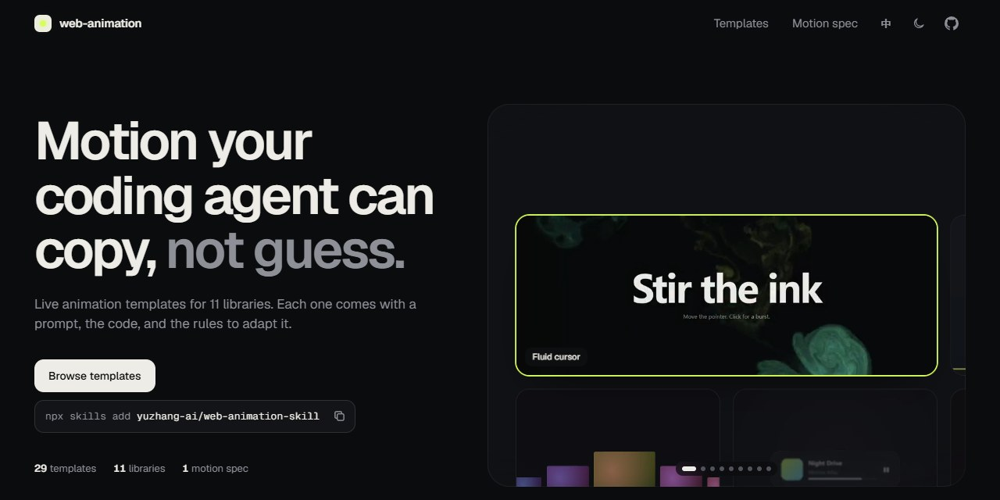
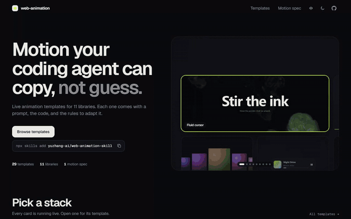

# Web Animation Skill

**Coding agents can't watch animations. This skill makes them check the frames.**

[](https://skills.sh/yuzhang-ai/web-animation-skill)
[](https://yuzhang-ai.github.io/web-animation-skill/)
[](#license)

```bash
npx skills add yuzhang-ai/web-animation-skill
```

Works with Claude Code, Codex, Cursor, GitHub Copilot and any agent that reads `SKILL.md`.

<p align="center">
  <a href="https://yuzhang-ai.github.io/web-animation-skill/">
    
  </a>
</p>
<p align="center">
  <a href="https://yuzhang-ai.github.io/web-animation-skill/">
    
  </a>
  <br>
  <a href="https://yuzhang-ai.github.io/web-animation-skill/"><b>Live showcase</b></a> · <a href="docs/media/demo.mp4">Full interactive tour (MP4, 26 s)</a> · every card runs the library its rule describes
</p>

## Why

- **It looks before it ships.** In the refine step the agent freezes time with Playwright's `page.clock`, screenshots fixed timestamps (0 / 120 / 240 / 480 ms) and checks them: no first-frame flash, no jumps, no element left at `opacity: 0`, reduced motion still works. Time is frozen, so each frame is exactly the moment it claims to be.
- **It picks the lightest tool.** CSS, View Transitions and scroll-driven animations first; GSAP, Motion, Anime.js v4, Three.js and 7 more libraries only when the job needs them. Every animation gets a reduced-motion version.
- **It writes current APIs.** `motion/react` instead of `framer-motion`, the Anime.js v4 API, GSAP plugins that are now free, dotLottie, three.js `setAnimationLoop`.

## Install

```bash
npx skills add yuzhang-ai/web-animation-skill
```

Or copy `SKILL.md` and `rules/` into your agent's skills folder (for example `.claude/skills/web-animation/`).

**Pairs well with** GreenSock's official [gsap-skills](https://github.com/greensock/gsap-skills): they go deep on GSAP itself, this skill decides when you need GSAP at all and how to verify the result.

## How it works

`SKILL.md` is the entry point. It gives the agent the workflow, a quick picker, the non-negotiables, and motion tokens. The agent then loads only the rule file it needs.

```
Brief    → one-line motion spec per element (+ its reduced-motion version)
Build    → lightest tool that does the job: CSS / native first, then a library
Animate  → transform & opacity, shared duration/easing tokens, interruptible
Refine   → capture frames at key timestamps and look at them; check perf
Render   → lazy-load, pause off-screen, export GIF/MP4 when asked
```

## Rules

| Area | Rule | Covers |
|---|---|---|
| **Process** | [workflow](rules/workflow.md) | Motion spec, tokens, timing rules of thumb, frame-by-frame verification with Playwright |
| | [choosing-library](rules/choosing-library.md) | Decision flow and matrix across native APIs and 11 libraries |
| | [accessibility](rules/accessibility.md) | `prefers-reduced-motion` per library, pause controls, WCAG 2.2.2 / 2.3.1 |
| | [performance](rules/performance.md) | Compositor-only properties, layout thrash, pausing off-screen loops |
| | [export](rules/export.md) | Deterministic capture → ffmpeg, MediaRecorder, gifenc |
| **Native** | [native-apis](rules/native-apis.md) | WAAPI, View Transitions, scroll-driven animations, `@starting-style`, `linear()` springs |
| | [css-keyframes](rules/css-keyframes.md) | `@keyframes`, staggering with custom properties |
| | [scroll-animations](rules/scroll-animations.md) | Scroll patterns across CSS, Motion, GSAP, Anime.js |
| **DOM / SVG** | [motion](rules/motion.md) | Motion (formerly Framer Motion + Motion One): React and vanilla |
| | [gsap](rules/gsap.md) | Timelines, ScrollTrigger, `useGSAP`, SplitText, MorphSVG, Flip (all free) |
| | [animejs](rules/animejs.md) | Anime.js **v4** API: stagger grids, `svg` module, `onScroll`, `createScope` |
| | [flubber](rules/flubber.md) | Standalone path morphing |
| | [d3](rules/d3.md) | Data joins and transition chaining |
| **Asset playback** | [lottie](rules/lottie.md) | lottie-web, dotLottie, `.lottie` format |
| | [rive](rules/rive.md) | State machines and inputs |
| **Canvas / WebGL** | [konva](rules/konva.md) | Interactive canvas: layers, drag, Transformer |
| | [two-js](rules/two-js.md) | Generative 2D vector scenes (SVG ⇄ canvas ⇄ WebGL) |
| | [proton](rules/proton.md) | Particle emitters, initializers, behaviours |
| | [three-js](rules/three-js.md) | Scenes, R3F, WebGPU, tweening 3D objects |

## What's new in v2

- **Current APIs.** These snippets would break if written the old way, so the skill now uses:
  - `framer-motion` → `motion` (`motion/react`), with Motion One merged in
  - Anime.js v4 rewrite
  - GSAP plugins now free, plus `useGSAP`
  - `@lottiefiles/dotlottie-react`
  - `THREE.Timer` and `setAnimationLoop`
- **Workflow first.** Agents can't watch animations, so the skill tells them how to verify one with captured frames.
- **New rules:** workflow, accessibility, native APIs, export, Proton, Two.js.
- **Showcase page** ([`docs/index.html`](docs/index.html)): a single static file that loads every library from jsDelivr and honours reduced motion. Highlights:
  - a flow-field hero with 2,600 particles
  - a noise-displaced iridescent shader sphere
  - spring chains fused by an SVG goo filter
  - a draggable verlet rope
  - Flubber one-to-many morphs
  - firework emitters
  - a CSS `view()` 3D drum picker

## Showcase page

`docs/index.html` is self-contained. To run it locally, serve the folder (`python -m http.server 8000 --directory docs`). Every push to `master` that touches `docs/` redeploys it to GitHub Pages through [`.github/workflows/pages.yml`](.github/workflows/pages.yml).

Regenerate the README media by recording the page (the deterministic method is in [export.md](rules/export.md)) and encoding it with ffmpeg.

## Scope

This skill is for **real-time browser animation**. For rendering videos as the final product, use [Remotion](https://github.com/remotion-dev/skills) or [Motion Canvas](https://github.com/motion-canvas/motion-canvas).

## License

MIT

---

If this saved your agent from one janky animation, a ⭐ helps other people find it.
