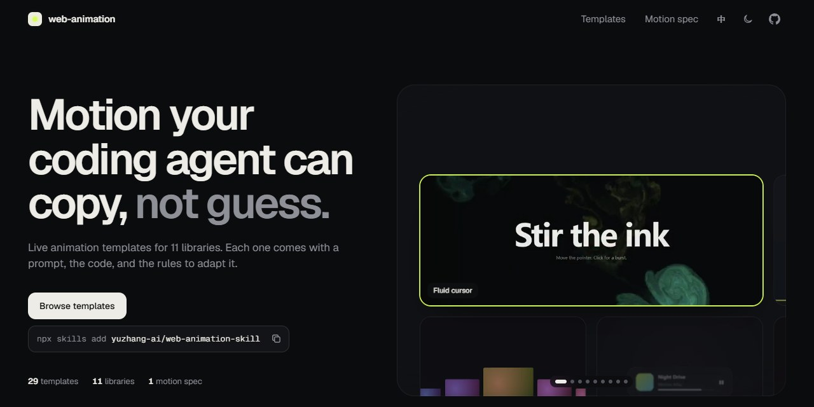
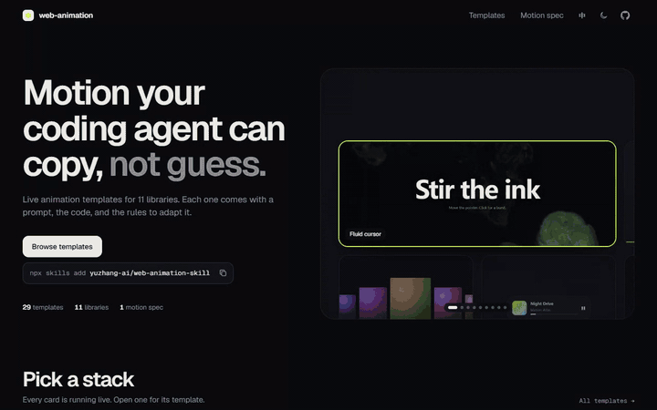

# Web Animation Skill

[English](README.md) · **简体中文**

**给 AI 编程助手的现成动效。** Agent 看不见动画，只能靠猜。这个 Skill 给它 29 个可直接改用的模板、一份决定动效节奏的规范，以及上线前逐帧检查的方法。

[](https://skills.sh/yuzhang-ai/web-animation-skill)
[](https://yuzhang-ai.github.io/web-animation-skill/)
[](https://yuzhang-ai.github.io/web-animation-skill/templates.html)
[](#许可)

```bash
npx skills add yuzhang-ai/web-animation-skill
```

适用于 Claude Code、Codex、Cursor、GitHub Copilot，以及任何会读取 `SKILL.md` 的 Agent。

<p align="center">
  <a href="https://yuzhang-ai.github.io/web-animation-skill/">
    <picture>
      <source media="(prefers-color-scheme: light)" srcset="docs/media/hero-light.jpg">
      
    </picture>
  </a>
</p>
<p align="center">
  <a href="https://yuzhang-ai.github.io/web-animation-skill/"></a>
  <br>
  <a href="https://yuzhang-ai.github.io/web-animation-skill/"><b>打开网站</b></a> · <a href="https://yuzhang-ai.github.io/web-animation-skill/templates.html">模板总览</a> · <a href="docs/media/demo.mp4">完整导览视频（MP4，32 秒）</a>
</p>

## 为什么好用

- **从能用的效果开始。** 写动效之前，Agent 先查 [templates/CATALOG.md](templates/CATALOG.md)，挑出最接近的模板来改。共 29 个模板，每个都是一个独立页面，附带提示词、值得调整的参数和常见的坑，全部在真实浏览器里检查过。能力弱一些的模型照着好例子改，效果远好于凭空发挥。
- **有依据地动。** [动效规范](spec/motion.md)写明了什么场景用什么曲线（进场、离场、急停、过冲、弹簧），按距离该用多长时间，以及每种控件状态怎么动。
- **上线前先看一眼。** Agent 用 Playwright 冻结时间，截取固定时刻的画面并检查：首帧不闪、过程不跳、没有元素卡在 `opacity: 0`，减弱动态效果时也能正常工作。
- **用的是当前的 API。** 用 `motion/react` 而不是 `framer-motion`，用 Anime.js v4 的新 API、已经免费的 GSAP 插件、COBE 2 的 `update()`、three.js 的 `setAnimationLoop`。

## 安装

```bash
npx skills add yuzhang-ai/web-animation-skill
```

也可以把 `SKILL.md`、`rules/`、`templates/` 和 `spec/` 复制到 Agent 的 skills 目录（例如 `.claude/skills/web-animation/`）。

**搭配使用：** GreenSock 官方的 [gsap-skills](https://github.com/greensock/gsap-skills) 专注于 GSAP 本身；这个 Skill 负责判断什么时候需要 GSAP，以及如何验证效果。

## 模板

共 29 个模板，覆盖 13 个技术栈。每个模板都能在线打开，带预览 / 代码 / 提示词三个标签，支持深浅两种主题和中英两种语言。提示词保持英文，AI 理解得更准确。

| 技术栈 | 模板 |
|---|---|
| CSS 与原生 API (11) | [View Transitions 网格](https://yuzhang-ai.github.io/web-animation-skill/t/view-transition-grid.zh.html) · [锥形渐变光环](https://yuzhang-ai.github.io/web-animation-skill/t/conic-ring.zh.html) · [拖拽视差画廊](https://yuzhang-ai.github.io/web-animation-skill/t/drag-parallax-track.zh.html) · [光晕卡片](https://yuzhang-ai.github.io/web-animation-skill/t/glow-cards.zh.html) · [无限跑马灯](https://yuzhang-ai.github.io/web-animation-skill/t/infinite-marquee.zh.html) · [果冻按钮](https://yuzhang-ai.github.io/web-animation-skill/t/jelly-button.zh.html) · [运动曲线对照](https://yuzhang-ai.github.io/web-animation-skill/t/motion-curves.zh.html) · [滚动 3D 滚轮](https://yuzhang-ai.github.io/web-animation-skill/t/scroll-drum-picker.zh.html) · [单图形形变 UI](https://yuzhang-ai.github.io/web-animation-skill/t/shape-morph-ui.zh.html) · [SVG 加载动画](https://yuzhang-ai.github.io/web-animation-skill/t/svg-spinners.zh.html) · [乱码解密文字](https://yuzhang-ai.github.io/web-animation-skill/t/text-scramble.zh.html) |
| GSAP (4) | [路径动画时间线](https://yuzhang-ai.github.io/web-animation-skill/t/motion-path-timeline.zh.html) · [翻牌字](https://yuzhang-ai.github.io/web-animation-skill/t/split-flap-words.zh.html) · [滚动布局重组](https://yuzhang-ai.github.io/web-animation-skill/t/scroll-layout-flip.zh.html) · [文字揭示](https://yuzhang-ai.github.io/web-animation-skill/t/split-text-reveal.zh.html) |
| Motion (1) | [弹簧黏液拖尾](https://yuzhang-ai.github.io/web-animation-skill/t/spring-goo-trail.zh.html) |
| Anime.js v4 (1) | [交错涟漪网格](https://yuzhang-ai.github.io/web-animation-skill/t/stagger-ripple-grid.zh.html) |
| Three.js 与 WebGL (4) | [幻彩球体](https://yuzhang-ai.github.io/web-animation-skill/t/iridescent-blob.zh.html) · [点阵地球](https://yuzhang-ai.github.io/web-animation-skill/t/dot-globe.zh.html) · [流体光标](https://yuzhang-ai.github.io/web-animation-skill/t/fluid-cursor.zh.html) · [墨水交界转场](https://yuzhang-ai.github.io/web-animation-skill/t/seam-transition.zh.html) |
| Canvas 2D (1) | [流场首屏](https://yuzhang-ai.github.io/web-animation-skill/t/flow-field-hero.zh.html) |
| D3 (1) | [环形图过渡](https://yuzhang-ai.github.io/web-animation-skill/t/donut-transition.zh.html) |
| Lottie (1) | [Lottie 点赞按钮](https://yuzhang-ai.github.io/web-animation-skill/t/lottie-like-button.zh.html) |
| Flubber (1) | [Flubber 形变](https://yuzhang-ai.github.io/web-animation-skill/t/flubber-morph.zh.html) |
| Two.js (1) | [顶点色块](https://yuzhang-ai.github.io/web-animation-skill/t/vertex-blobs.zh.html) |
| Konva (1) | [画布编辑器](https://yuzhang-ai.github.io/web-animation-skill/t/canvas-editor.zh.html) |
| Proton (1) | [粒子烟花](https://yuzhang-ai.github.io/web-animation-skill/t/particle-fireworks.zh.html) |
| 导出 (1) | [GIF 导出](https://yuzhang-ai.github.io/web-animation-skill/t/gif-export.zh.html) |

在[模板总览](https://yuzhang-ai.github.io/web-animation-skill/templates.html)里浏览。改编和参考的来源列在 [THIRD_PARTY.md](THIRD_PARTY.md)。

## 工作方式

`SKILL.md` 是入口。Agent 先找相近的模板，按动效规范定节奏；没有合适的模板时，按下面的流程、配合需要的那一份规则文件来做。

```
Brief    → 每个运动元素写一行动效说明（以及它的减弱动态效果版本）
Build    → 最接近的模板；没有就选最轻的工具：先 CSS / 原生，再用库
Animate  → 只动 transform 和 opacity，共用时长 / 缓动参数，可被打断
Refine   → 在关键时间点截帧查看；检查性能
Render   → 懒加载，离屏暂停，需要时导出 GIF / MP4
```

## 规则

| 类别 | 规则 | 内容 |
|---|---|---|
| **流程** | [workflow](rules/workflow.md) | 动效说明、时长与缓动参数、经验法则、用 Playwright 逐帧验证 |
| | [art-direction](rules/art-direction.md) | 气质、配色与字体；一个招牌效果；节奏与密度；交互细节配方 |
| | [choosing-library](rules/choosing-library.md) | 原生 API 与 11 个库的选择流程和对比表，以及免构建页面用的固定版本 CDN 地址 |
| | [accessibility](rules/accessibility.md) | 各个库的 `prefers-reduced-motion` 写法、暂停控件、WCAG 2.2.2 / 2.3.1 |
| | [performance](rules/performance.md) | 只走合成层的属性、布局抖动、离屏暂停循环 |
| | [export](rules/export.md) | 确定性逐帧捕获 → ffmpeg、MediaRecorder、gifenc |
| **原生** | [native-apis](rules/native-apis.md) | WAAPI、View Transitions、滚动驱动动画、`@starting-style`、`linear()` 弹簧 |
| | [css-keyframes](rules/css-keyframes.md) | `@keyframes`、用自定义属性做交错 |
| | [scroll-animations](rules/scroll-animations.md) | CSS、Motion、GSAP、Anime.js 的滚动动画模式 |
| **DOM / SVG** | [motion](rules/motion.md) | Motion（原 Framer Motion + Motion One）：React 与原生 |
| | [gsap](rules/gsap.md) | 时间线、ScrollTrigger、`useGSAP`、SplitText、MorphSVG、Flip（全部免费） |
| | [animejs](rules/animejs.md) | Anime.js **v4** API：交错网格、`svg` 模块、`onScroll`、`createScope` |
| | [flubber](rules/flubber.md) | 独立的路径形变 |
| | [d3](rules/d3.md) | 数据绑定与过渡链 |
| **素材播放** | [lottie](rules/lottie.md) | lottie-web、dotLottie、`.lottie` 格式 |
| | [rive](rules/rive.md) | 状态机与输入 |
| **Canvas / WebGL** | [konva](rules/konva.md) | 交互式画布：图层、拖拽、Transformer |
| | [two-js](rules/two-js.md) | 生成式 2D 矢量场景（SVG ⇄ canvas ⇄ WebGL） |
| | [proton](rules/proton.md) | 粒子发射器、初始化器、行为 |
| | [three-js](rules/three-js.md) | 场景、R3F、WebGPU、补间 3D 对象 |

## 网站与工具

网站由 [docs/](docs/)（首页、模板总览）、[templates/](templates/)，以及为每个模板、每种语言生成的详情页组成。每次推送到 `master` 且改动了这些内容，都会通过 [.github/workflows/pages.yml](.github/workflows/pages.yml) 重新部署。

| 命令 | 作用 |
|---|---|
| `node scripts/build-catalog.mjs` | 根据各模板的 `meta.json` 重新生成 `templates/catalog.json`、`CATALOG.md` 和 `THIRD_PARTY.md` |
| `node scripts/build-site.mjs` | 组装 `_site/`，与 Pages 部署的内容完全一致 |
| `node scripts/check-templates.mjs` | 在 Chromium 里打开每个模板：控制台报错、手机宽度溢出、减弱动态效果 |
| `node scripts/check-site.mjs` | 对网站做整页检查，覆盖两种语言和两种主题 |
| `node scripts/record-previews.mjs` | 为每个模板录制深浅两版预览视频 |
| `node scripts/record-readme.mjs` | 重新生成本页的配图和导览视频 |

检查脚本需要 Playwright（`npm i -D playwright`），录制脚本需要 ffmpeg。

**新增模板：** 新建 `templates/<id>/`，放入 `index.html`、`prompt.md`（Effect、Use it for、Prompt 代码块、Knobs、Pitfalls）和 `meta.json`；在 `templates/i18n.zh.json` 里补上中文文案；然后运行目录、检查和录制脚本。

## 适用范围

这个 Skill 面向**浏览器里的实时动画**。如果最终产物是视频，请使用 [Remotion](https://github.com/remotion-dev/skills) 或 [Motion Canvas](https://github.com/motion-canvas/motion-canvas)。

## 许可

MIT

---

如果它帮你的 Agent 少做了一个卡顿的动画，点个 ⭐ 能让更多人看到它。
